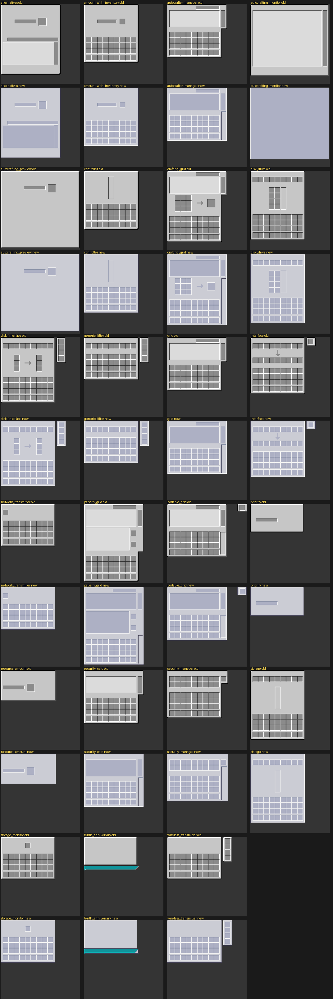
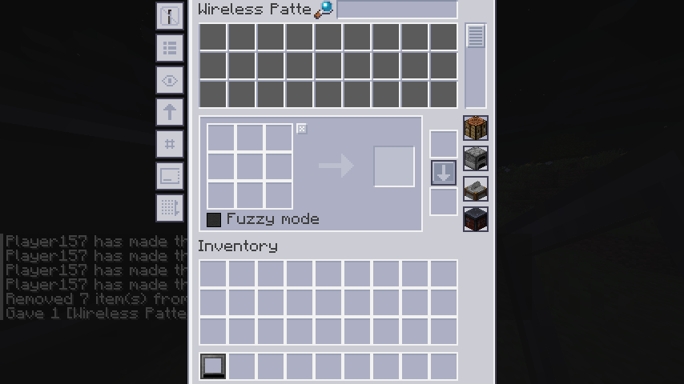

# EZ2RS

Refined Storage 2 的附属模组（Fabric 1.21.1）。

## 功能

### 1. 自动合成预览：缺失原料置顶（AE2 风格）

凡是缺失的原料的条目会被整体移到列表最前面，
组内保持 RS2 原本的计算顺序，其余条目顺序不变（稳定分区，不重排、不丢项）。

### 2. 样板输入 / 输出预览（ExtendedAE 风格，默认 P 键）

在任意容器界面里把鼠标悬停在样板物品上，按 **P** 弹出预览界面。
有副产品时在下方单独一栏并带分隔线。（是的，RS 有副产机制，但是和 AE 的不一样）

### 3. GUI 换成 AE2 1.21.1 风格（内建材质包）

整个 RS2 的 GUI 被重做成 AE2 1.21.1 风格，
以**内建材质包**形式随模组发布。



### 4. 通用终端（可切换的无线终端）

一个物品承载多种无线终端，左侧按钮栏点一下切一页，顺序与单独使用该终端完全一致
（打开动作直接委托给 RS2 / 石英兵工厂自己的无线物品，权限、网络绑定、菜单界面全部复用）。

**刚合成出来是空终端**，需要用对应的无线终端与它合成来解锁其他终端：

| 合成 | 解锁的页 |
|---|---|
| 通用终端 + 无线终端 | 终端 |
| 通用终端 + 无线合成终端（石英兵工厂） | 合成终端 |
| 通用终端 + 无线自动合成监视器 | 自动合成监视器 |
| 通用终端 + 无线样板终端 | 样板终端（无线编码样板页） |

另有一个独立物品「无线样板终端」，适合只想随身带一个样板编码器的情况：

```
石英强化铁   末影珍珠    石英强化铁
高级处理器   样板终端    高级处理器
石英强化铁   末影珍珠    石英强化铁
```

- 页按合成先后追加。已经解锁过的类型重复合成不会重复加页。
- 通用终端电力：网络可达时从网络取电，不消耗内部电池；离开网络后回退到内部电池。
- 无线样板终端的草稿（样板物品、矩阵内容、样板类型等）保存在当前终端物品中，
  关闭界面再打开时恢复。通用终端样板页与独立无线样板终端采用相同的保存格式，
  不同物品的草稿各自独立。

### 5. 无线样板终端

独立物品 `ez2rs:wireless_pattern_grid`，能随时随地在网络上编码样板。

支持合成 / 处理 / 切石机 / 锻造四种样板，行为与方块版一致：

- 把已编码的样板放进编码输出槽，会**自动切到该样板的类型**并把内容回填到对应矩阵
- Clear 按钮清空当前类型的编辑矩阵
- 处理样板的矩阵槽位数与备选原料配置与方块版相同



### 6. 样板数量快速乘除（×2 ×3 ×5 ×7 / ÷2 ÷3 ÷5 ÷7）

处理样板里往往要填「这个原料一次要几个」。手点数量界面一格一格改很慢，
所以样板终端右侧多了一列按钮，点一下就把**所有已填写的处理输入与输出**同时缩放：

| 按钮 | 效果 |
|---|---|
| ×2 / ×3 / ×5 / ×7 | 每一格数量乘以对应因子 |
| ÷2 / ÷3 / ÷5 / ÷7 | 每一格数量除以对应因子 |

- **只对处理样板生效**：合成 / 切石机 / 锻造的原料数量在 RS2 里恒为 1
  （`PatternResolver` 对它们硬编码 `Ingredient(1, ...)`），缩放没有意义，
  所以那三种模式下按钮直接隐藏。
- **方块版与无线版同时可用**：两个终端共用同一个界面类，一次注入两边都有。
- **除法是四舍五入且下限为 1**，不是「除不尽就放弃」。参考模组
  （[Pattern-Encoding-Terminal-Quick-Math](https://github.com/oritong/Pattern-Encoding-Terminal-Quick-Math)）
  在除不尽时整次操作作废，这里改成四舍五入，避免玩家一路除下去把整行原料除没。
- **乘法上限由 RS2 自己夹**：物品夹到堆叠上限、流体夹到桶容量 ×64，
  与手动输入数量时的上限完全一致。
- 配置过的「备选原料」标签在缩放后**保持不变**（原生数量输入会清掉它们，这里补回去了）。

## 版本

| 项 | 值 |
|---|---|
| Minecraft | 1.21.1 |
| Fabric Loader | 0.19.3 |
| Fabric API | 0.116.17+1.21.1 |
| Fabric Loom | 1.17.19 |
| Refined Storage | 2.0.9（声明区间 `>=2.0.0 <3.0.0`） |
| Refined Storage - Quartz Arsenal | 1.0.8（硬依赖，提供无线合成终端） |
| Refined Storage EMI Integration | 1.0.0（新增的直接硬依赖） |
| EMI | 1.1.22+1.21.1（由集成桥要求安装，开发环境使用此版本） |
| Java | 21 |

玩家环境需同时安装 EMI 与官方 RS2 EMI 集成桥；Fabric Loader 会检查依赖，
不会自动下载模组。EZ2RS 的元数据只直接声明集成桥，EMI 由集成桥的依赖声明要求。

## 构建

```bash
./gradlew build          # 产物：build/libs/ez2rs-0.1.0.jar
./gradlew runClient      # 开发环境起客户端
./gradlew runServer      # 开发环境起服务端
```

RS2 的 Fabric 产物来自 CreeperHost maven（`https://maven.creeperhost.net`）。
石英兵工厂的 jar 放在 `libs/`——Modrinth 的产物没有 loom 的 mod 变体元数据，
走 maven 坐标时 loom 不会重映射，dev 运行时 loader 会认为没装这个模组。
RS2 自身的运行期依赖（cloth-config、team reborn energy）在正式环境由 RS2 jar 内的嵌套 jar 提供，
但 dev 运行需要显式声明，`build.gradle` 里已作为 `modImplementation` 加上（不会打进本模组的 jar）。
EMI 与官方集成桥也作为开发依赖解析，版本分别固定为 `1.1.22+1.21.1` 和 `1.0.0`；
它们同样不会嵌入 EZ2RS 的发布 jar。

---

以下为实现细节

## 实现

### 功能 1：预览缺失置顶

单点 mixin：`ar.hxi.ez2rs.mixin.PreviewMixin`，注入
`com.refinedmods.refinedstorage.api.autocrafting.preview.Preview#items()` 的 `RETURN`。

选择访问器而不是 `Preview` 构造器作为注入点，原因有三：

1. 服务端把预览序列化下发时走 `Preview::items`（`AutocraftingPreviewResponsePacket` 的 codec），
   客户端反序列化后渲染列表也走它 —— 一处注入即可覆盖两端；
2. 因此**只装客户端**也能看到排序；**只装服务端**时，下发的数据已是排好序的，
   未装本模组的客户端同样能看到缺失项置顶；
3. 不触碰 record 的 final 字段，也不需要往构造器 HEAD 注入 `this`。

没有任何缺失项时原样返回入参列表，不做额外分配。

### 功能 2：样板预览界面

- `ar.hxi.ez2rs.client.Ez2rsClient`：注册 keybind（`KeyBindingHelper`），
  用 Fabric 的 `ScreenEvents.AFTER_INIT` + `ScreenKeyboardEvents.allowKeyPress` 拦截按键，
  命中时返回 `false` 吞掉事件。
- `ar.hxi.ez2rs.client.PatternPreviewScreen`：预览界面。资源渲染走 RS2 的
  `RefinedStorageClientApi.INSTANCE.getResourceRendering(...)`，槽位与箭头复用 RS2 的
  `Sprites.SLOT` / `Sprites.LIGHT_ARROW` 精灵，数值用 `formatAmount(amount, true)`（1k / 1M）。
- `ez2rs.accesswidener`：1.21.1 mojmap 里 `AbstractContainerScreen#hoveredSlot` 是 protected
  且没有公开 getter，用它取鼠标下的槽位。选 AW 而不是 mixin accessor 的原因：loom 会把 AW
  从 named 重映射到 intermediary 写进 jar，不需要 mixin refmap（本项目没有启用 mixin 注解处理器）。

### 功能 3：AE2 风格材质包

`tools/ae2ify_gui.py` 是生成器，输出到 `src/main/resources/resourcepacks/ae2_gui/`，
由 `Ez2rsClient#registerGuiPack` 用 `ResourceManagerHelper.registerBuiltinResourcePack` 注册
（默认关闭，玩家在「选项 → 资源包」里开启）。

不是整体调色，而是结构重绘：

| 部件 | 画法 |
|---|---|
| 面板 | 最外 1px `#413F54` 深描边 → 次外 1px `#F2F2F2` 亮白 → 主体 `#CBCCD4` |
| 选框 | 外圈 1px 白 → 主体 `#ADB0C4`，主体顶行 1px `#9A9FB4` 当投影 |
| 槽位 | 18x18 格内 1px 白圈 + 顶行投影 + 主体，相邻格合成 2px 白格网 |
| 按钮 | 扁平：1px 描边 + 纯色主体，状态靠主体色区分 |
| 图标 | 保语义，只按绝对亮度落到 AE2 灰阶；彩色（进度条青、错误红等）原样保留 |

几个关键处理：

- **外轮廓**按 alpha 连通域拉平成矩形再重画边框。旧图的边框带用「透明遮罩膨胀 3px」判定，
  这样外轮廓、缺口、台阶、圆角都能覆盖，否则旧像素会被当结构贴回来（表现为「格子有花边」）。
- **烘在底图里的槽位**按 `#8B8B8B` 连通域识别，16x16 与 22x22（合成输出大槽）统一处理。
- **透明底的槽位贴图**（`pattern_grid/crafting.png` 这类）走单独路径：只重绘检测到的槽位，
  其余调色、alpha 保留，不然面板会盖掉箭头和输出槽。
- **小图标**用绝对亮度落档而非 nearest 映射，否则 `move_down_disabled` 这种 28/70/130 的
  深灰字形会被压成和底色一样的值、整个消失。

### 功能 4 / 5：通用终端与无线样板终端

**初始化分两阶段**，这是本模组唯一和加载时序相关的硬约束：

| 阶段 | 入口 | 做什么 |
|---|---|---|
| 1 | Fabric `main` → `Ez2rs#onInitialize` | 只注册数据组件（完全不碰 RS2 的类） |
| 2 | RS2 `refinedstorage_plugin` → `Ez2rs#onApiAvailable` | 菜单、配方序列化器、网络包、物品、能量、创造栏 |

原因：`RefinedStorageApi.INSTANCE` 是代理，delegate 要到 RS2 自己的 `ModInitializerImpl#onInitialize`
里调用 `initializePlatformApi()` 时才装上去；在那之前碰任何 RS2 编解码器都会抛
`IllegalStateException: API not loaded yet`。而 Fabric 的 `main` 入口按**模组顺序**逐个调用，
开发环境里 `FabricLoaderImpl` 会 `Collections.shuffle(modCandidates)`，谁先跑每次都不一样。
（正式环境按 mod id 升序，`"ez2rs" < "refinedstorage"`，我们永远先跑——所以只把逻辑放对不够，
必须靠 `refinedstorage_plugin` 入口来兜底正确的时机。）

一旦抢跑，`ResourceCodecs` 的类初始化会被永久标记为失败，RS2 随后在 `StorageTypes.<clinit>`
抛 `NoClassDefFoundError`，整条启动链彻底崩且无法重试。
`./gradlew runClient` 可加 `-Dfabric.debug.disableModShuffle` 复现/排除顺序问题。

内容注册走 RS2 的 `refinedstorage_plugin` 入口（`Ez2rs#onApiAvailable`），
因为物品必须进 RS2 已经准备好的注册表；数据组件在 `onInitialize` 注册，
菜单 / 配方 / 网络包在 `onApiAvailable` 里注册，两处都用标志位保证只执行一次。

**三种现成无线终端的切换**直接委托给 RS2 / 石英兵工厂自己的无线物品
（`Items.INSTANCE.getWirelessGrid().use(...)`），权限检查、网络绑定、菜单与界面全部复用。

无线样板终端采用 **RS2 原生状态对象 + 无线网络适配**：

- 服务端创建一个未放置的 `PatternGridBlockEntity` 子类，作为样板编辑状态的载体。
  它持有世界引用用于配方与注册表查询，但不会注册进区块、方块实体表、ticker 或 RS 网络。
  `setChanged()` 仅记录物品草稿变化，不调用区块保存或方块更新。
- 服务端菜单通过同包桥接调用 RS2 的方块实体构造器；客户端仍使用原生快照构造器。
  四类样板编码、结果计算、已编码样板回填、Clear、属性和资源槽同步全部复用 RS2。
  不再用客户端构造器模拟服务端，也不再复制四套配方填充和编码实现。
- 网络资源、权限、存取操作和能量消耗基于 RS2 的 `WirelessGrid` / `NetworkItemContext`。
  无线适配层维护监听器的绑定与释放，并处理网络失效、恢复时的资源刷新。
- 原生转移逻辑通过小范围排序上下文适配读取无线网络库存和可合成输出；
  其余普通方块样板终端继续使用原来的网络节点。
- EMI 按菜单类型注册处理器。我们为无线菜单注册官方集成桥的原生样板处理器，
  直接复用它的配方、数量、流体和提示转换，Fill Recipe 由原生 C2S 包交给服务端状态执行。
- 菜单保留自己的类型及打开数据 codec，保护手持终端槽位，并把草稿写回当前物品。
  旧草稿键保持可读，新增切石机选中配方字段；处理输入的备选标签配置按原生容器格式保存。

网络不可用时，网络资源区为空、不可进行网络操作，已有样板草稿保留并进入只读状态。
重新打开或恢复有效连接后按当前网络状态刷新。内部实现针对上表列出的版本核对；
元数据中的较宽 RS2 版本区间不代表其他版本已经过测试。

### 电力

`NetworkItemContextImplMixin` 注入 RS2 的 `NetworkItemContextImpl`：
网络可达时 `isActive()` 用网络电量、`drainEnergy()` 从网络扣，跳过物品内部电池；
网络不可达则回退到原逻辑。只对本模组的物品生效。

### 功能 6：快速乘除

- 客户端：`ar.hxi.ez2rs.mixin.PatternGridScreenQuickMathMixin` 注入 `PatternGridScreen#init()`
  的 `TAIL`，用 Fabric 的 `Screens#getButtons` 往面板右边缘外挂 8 个 `QuickMathButton`
  （RS2 的 `AbstractSideButtonWidget` 子类，18×18 底图 + 16×16 自绘图标，
  贴图在 `assets/ez2rs/textures/gui/sprites/quick_math/`）。
  按钮同时登记进 `getExclusionZones()`，EMI 的配方面板据此避开这一列。
- 服务端：`QuickMathPacket`（C2S，只带一个 `VAR_INT` 因子）交给
  `Ez2rsQuickMathBridge#applyFactor`，遍历 `menu.getResourceSlots()` 中
  `canModifyAmount()` 且非空的槽（在样板终端里就是处理矩阵槽），
  调用与原生数量界面同一条 `ResourceSlot#changeAmount(long)`。
- 为什么服务端<b>不</b>判断样板类型：服务端的同名字段是 `ServerProperty`，`getValue()` 会抛
  `UnsupportedOperationException`；而且没有必要——合成 / 切石 / 锻造的原料根本不在
  `ResourceSlot` 里带着数量，遍历到的只会是处理矩阵槽。
- 备选原料：`ProcessingMatrixInputResourceContainer#setSilently` 会把 `allowedTagIds[index]`
  重置为空集，所以 `applyFactor` 先快照、缩放后原样写回，玩家配置的备选标签不会丢。
- 无线终端：额外走 `WirelessPatternGridContainerMenu#ez2rs$acceptsQuickMath()` 的
  `canEdit()` 闸门，断网或已关闭时拒绝写入，与其它写操作一致。
- 自绘贴图没有复用参考模组的任何素材（其许可为 GPLv3），墨色 `(58,58,58)` 对齐 RS2 图标。

## 已验证

- 功能 1：dev 服务端实机跑过，mixin 正常应用；构造 `[toCraft=3, missing=7, toCraft=1, missing=2]`
  的预览后 `items()` 返回 `[missing=7, missing=2, toCraft=3, toCraft=1]`。
- 功能 2：dev 客户端实机跑过，access widener 运行时确认生效（`hoveredSlot` 修饰符为 `public`）。
- 功能 3：24 张底图与 148 张 sprite 逐张比对过；覆盖机制确认
  （`grid.png source pack = ez2rs:ae2_gui`）。
- 功能 4：三个终端切换在实机跑过，界面正常渲染。
- 功能 5：重构前，使用方已反馈四类样板编码、类型切换、Clear、网络存取和 EMI 拖放可用；
  EMI Fill Recipe 曾出现按钮可点击但填充失败。重构后的完整交互仍需游戏内回归验证，
  构建成功不代表这些交互已经实测通过。
- 功能 6：编译通过，mixin 注入点与描述符在产物 jar 里核对过
  （`init()V` → `method_25426()V`、`containerTick()V` → `method_37432()V`、
  `patternTypeChanged` 保持 `remap = false`）；**游戏内点击效果仍需实测**。

## 关于 RS2 的副产品

`PatternLayout` 带 `byproducts` 字段，但只有**合成样板**会真的带上：`PatternResolver` 取
`recipe.getRemainingItems(...)`，也就是原版合成剩余物（桶、瓶子之类）。切石 / 锻造样板写死
`List.of()`，处理样板走 `PatternLayout.external(...)`，而 external 明确禁止副产品。
执行时 `InternalTaskPattern#step` 会把副产品塞回存储 —— 但 RS2 自身没有任何 tooltip 或界面
显示它们，所以预览界面里的副产品一栏是新增信息。
