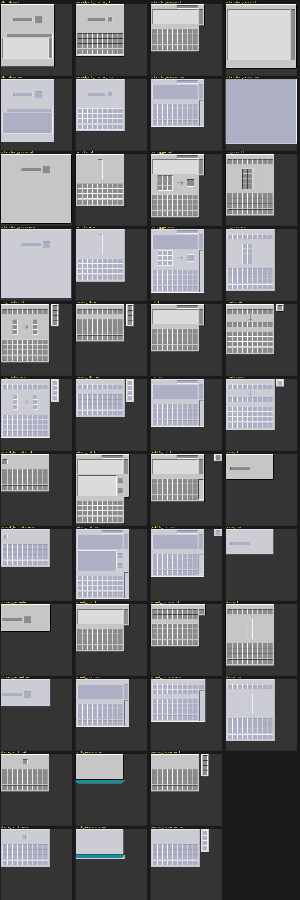

# EZ2RS

Refined Storage 2 的附属模组（Fabric 1.21.1）。

## 功能

### 1. 自动合成预览：缺失原料置顶（AE2 风格）

凡是缺失的原料的条目会被整体移到列表最前面，
组内保持 RS2 原本的计算顺序，其余条目顺序不变（稳定分区，不重排、不丢项）。

### 2. 样板输入 / 输出预览（ExtendedAE 风格，默认 P 键）

在任意容器界面里把鼠标悬停在样板物品上，按 **P** 弹出预览界面。
有副产品时在下方单独一栏并带分隔线。（是的，RS有副产机制，但是和 AE 的不一样）
样板无法解析（例如合成配方已失效）时按 P 不响应。


### 3. GUI 换成 AE2 1.21.1 风格（内建材质包）

整个 RS2 的 GUI 被重做成 AE2 1.21.1 风格，
以**内建材质包**形式随模组发布。




---
以下 LLM 生成的实现细节

### 4. 通用终端（可切换的无线终端）

一个物品承载多种无线终端，左侧按钮栏点一下切一页，顺序与单独使用该终端完全一致
（打开动作直接委托给 RS2 / 石英兵工厂自己的无线物品，权限、网络绑定、菜单界面全部复用）。

**刚合成出来是空终端**，右键不打开任何界面；需要用对应的无线终端与它合成来解锁一页：

| 合成 | 解锁的页 |
|---|---|
| 通用终端 + 无线终端 | 终端 |
| 通用终端 + 无线合成终端（石英兵工厂） | 合成终端 |
| 通用终端 + 无线自动合成监视器 | 自动合成监视器 |

- 用来解锁的终端**会被消耗**；页按合成先后追加。
- 已经解锁过的类型重复合成不会重复加页。
- 能量：网络可达时从网络取电，不消耗内部电池；离开网络后回退到内部电池。

## 实现

### 功能 1

单点 mixin：`ar.hxi.ez2rs.mixin.PreviewMixin`，注入
`com.refinedmods.refinedstorage.api.autocrafting.preview.Preview#items()` 的 `RETURN`。

选择访问器而不是 `Preview` 构造器作为注入点，原因有三：

1. 服务端把预览序列化下发时走 `Preview::items`（`AutocraftingPreviewResponsePacket` 的 codec），
   客户端反序列化后渲染列表也走它 —— 一处注入即可覆盖两端；
2. 因此**只装客户端**也能看到排序；**只装服务端**时，下发的数据已是排好序的，
   未装本模组的客户端同样能看到缺失项置顶；
3. 不触碰 record 的 final 字段，也不需要往构造器 HEAD 注入 `this`。

没有任何缺失项时原样返回入参列表，不做额外分配。

### 功能 2

- `ar.hxi.ez2rs.client.Ez2rsClient`：注册 keybind（`KeyBindingHelper`），
  用 Fabric 的 `ScreenEvents.AFTER_INIT` + `ScreenKeyboardEvents.allowKeyPress` 拦截按键，
  命中时返回 `false` 吞掉事件。
- `ar.hxi.ez2rs.client.PatternPreviewScreen`：预览界面。资源渲染走 RS2 的
  `RefinedStorageClientApi.INSTANCE.getResourceRendering(...)`，槽位与箭头复用 RS2 的
  `Sprites.SLOT` / `Sprites.LIGHT_ARROW` 精灵，数值用 `formatAmount(amount, true)`（1k / 1M）。
- `ez2rs.accesswidener`：1.21.1 mojmap 里 `AbstractContainerScreen#hoveredSlot` 是 protected
  且没有公开 getter，用它取鼠标下的槽位。选 AW 而不是 mixin accessor 的原因：loom 会把 AW
  从 named 重映射到 intermediary 写进 jar，不需要 mixin refmap（本项目没有启用 mixin 注解处理器）。

## 版本

| 项 | 值 |
|---|---|
| Minecraft | 1.21.1 |
| Fabric Loader | 0.19.3 |
| Fabric API | 0.116.17+1.21.1 |
| Fabric Loom | 1.17.19 |
| Refined Storage | 2.0.9（声明区间 `>=2.0.0 <3.0.0`） |
| Java | 21 |

## 构建

```bash
./gradlew build          # 产物：build/libs/ez2rs-0.1.0.jar
./gradlew runClient      # 开发环境起客户端
./gradlew runServer      # 开发环境起服务端
```

RS2 的 Fabric 产物来自 CreeperHost maven（`https://maven.creeperhost.net`）。
RS2 自身的运行期依赖（cloth-config、team reborn energy）在正式环境由 RS2 jar 内的嵌套 jar 提供，
但 dev 运行需要显式声明，`build.gradle` 里已作为 `modImplementation` 加上（不会打进本模组的 jar）。

## 已验证

- 功能 1：dev 服务端（MC 1.21.1 + Loader 0.19.3 + RS2 2.0.9）实机跑过，mixin 正常应用；
  构造 `[toCraft=3, missing=7, toCraft=1, missing=2]` 的预览后 `items()` 返回
  `[missing=7, missing=2, toCraft=3, toCraft=1]`。
- 功能 2：dev 客户端实机跑过，截图见上；access widener 运行时确认生效
  （`hoveredSlot` 修饰符为 `public`）。

## 关于 RS2 的副产品

`PatternLayout` 带 `byproducts` 字段，但只有**合成样板**会真的带上：`PatternResolver` 取
`recipe.getRemainingItems(...)`，也就是原版合成剩余物（桶、瓶子之类）。切石 / 锻造样板写死
`List.of()`，处理样板走 `PatternLayout.external(...)`，而 external 明确禁止副产品。
执行时 `InternalTaskPattern#step` 会把副产品塞回存储 —— 但 RS2 自身没有任何 tooltip 或界面
显示它们，所以预览界面里的副产品一栏是新增信息。
