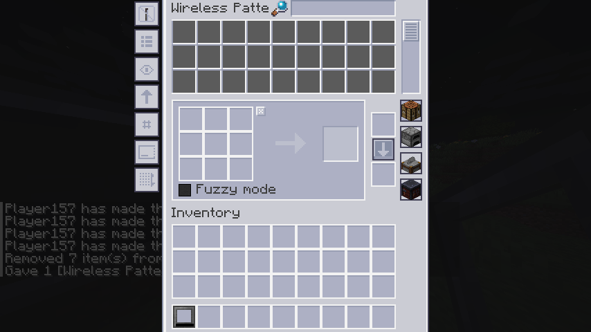

# EZ2RS

Refined Storage 2 的附属模组（Fabric 1.21.1）。

## 功能

### 1. 自动合成预览：缺失原料置顶（AE2 风格）

凡是缺失的原料的条目会被整体移到列表最前面，
组内保持 RS2 原本的计算顺序，其余条目顺序不变（稳定分区，不重排、不丢项）。

### 2. 样板输入 / 输出预览（ExtendedAE 风格，默认 P 键）

在任意容器界面里把鼠标悬停在样板物品上，按 **P** 弹出预览界面。
有副产品时在下方单独一栏并带分隔线。（是的，RS 有副产机制，但是和 AE 的不一样）

### 3. GUI 换成 AE2 1.21.1 风格（内建材质包）

整个 RS2 的 GUI 被重做成 AE2 1.21.1 风格，
以**内建材质包**形式随模组发布。


### 4. 通用终端（可切换的无线终端）

一个物品承载多种无线终端，左侧按钮栏点一下切一页，顺序与单独使用该终端完全一致
（打开动作直接委托给 RS2 / 石英兵工厂自己的无线物品，权限、网络绑定、菜单界面全部复用）。

**刚合成出来是空终端**，需要用对应的无线终端与它合成来解锁其他终端：

| 合成 | 解锁的页 |
|---|---|
| 通用终端 + 无线终端 | 终端 |
| 通用终端 + 无线合成终端（石英兵工厂） | 合成终端 |
| 通用终端 + 无线自动合成监视器 | 自动合成监视器 |
| 通用终端 + 样板终端（方块） | 样板终端（无线编码样板页） |

另有一个独立物品「无线样板终端」，适合只想随身带一个样板编码器的情况：

```
石英强化铁   末影珍珠    石英强化铁
高级处理器   样板终端    高级处理器
石英强化铁   末影珍珠    石英强化铁
```

- 页按合成先后追加。已经解锁过的类型重复合成不会重复加页。
- 电力：网络可达时从网络取电，不消耗内部电池；离开网络后回退到内部电池。
- 无线样板终端的草稿（未取走的样板、摆在矩阵里的材料、样板类型）会存进物品，
  关掉界面再打开原样恢复；通用终端的样板页与独立物品共用同一套草稿。

### 5. 无线样板终端

独立物品 `ez2rs:wireless_pattern_grid`，能随时随地在网络上编码样板。

支持合成 / 处理 / 切石机 / 锻造四种样板，行为与方块版一致：

- 把已编码的样板放进模板槽，会**自动切到该样板的类型**并把内容回填到对应矩阵
- Clear 按钮清空当前草稿
- 处理样板的矩阵槽位数与备选原料配置与方块版相同



## 版本

| 项 | 值 |
|---|---|
| Minecraft | 1.21.1 |
| Fabric Loader | 0.19.3 |
| Fabric API | 0.116.17+1.21.1 |
| Fabric Loom | 1.17.19 |
| Refined Storage | 2.0.9（声明区间 `>=2.0.0 <3.0.0`） |
| Refined Storage - Quartz Arsenal | 1.0.8（硬依赖，提供无线合成终端） |
| Java | 21 |

## 构建

```bash
./gradlew build          # 产物：build/libs/ez2rs-0.1.0.jar
./gradlew runClient      # 开发环境起客户端
./gradlew runServer      # 开发环境起服务端
```

RS2 的 Fabric 产物来自 CreeperHost maven（`https://maven.creeperhost.net`）。
石英兵工厂的 jar 放在 `libs/`——Modrinth 的产物没有 loom 的 mod 变体元数据，
走 maven 坐标时 loom 不会重映射，dev 运行时 loader 会认为没装这个模组。
RS2 自身的运行期依赖（cloth-config、team reborn energy）在正式环境由 RS2 jar 内的嵌套 jar 提供，
但 dev 运行需要显式声明，`build.gradle` 里已作为 `modImplementation` 加上（不会打进本模组的 jar）。

---

以下为实现细节

## 实现

### 功能 1：预览缺失置顶

单点 mixin：`ar.hxi.ez2rs.mixin.PreviewMixin`，注入
`com.refinedmods.refinedstorage.api.autocrafting.preview.Preview#items()` 的 `RETURN`。

选择访问器而不是 `Preview` 构造器作为注入点，原因有三：

1. 服务端把预览序列化下发时走 `Preview::items`（`AutocraftingPreviewResponsePacket` 的 codec），
   客户端反序列化后渲染列表也走它 —— 一处注入即可覆盖两端；
2. 因此**只装客户端**也能看到排序；**只装服务端**时，下发的数据已是排好序的，
   未装本模组的客户端同样能看到缺失项置顶；
3. 不触碰 record 的 final 字段，也不需要往构造器 HEAD 注入 `this`。

没有任何缺失项时原样返回入参列表，不做额外分配。

### 功能 2：样板预览界面

- `ar.hxi.ez2rs.client.Ez2rsClient`：注册 keybind（`KeyBindingHelper`），
  用 Fabric 的 `ScreenEvents.AFTER_INIT` + `ScreenKeyboardEvents.allowKeyPress` 拦截按键，
  命中时返回 `false` 吞掉事件。
- `ar.hxi.ez2rs.client.PatternPreviewScreen`：预览界面。资源渲染走 RS2 的
  `RefinedStorageClientApi.INSTANCE.getResourceRendering(...)`，槽位与箭头复用 RS2 的
  `Sprites.SLOT` / `Sprites.LIGHT_ARROW` 精灵，数值用 `formatAmount(amount, true)`（1k / 1M）。
- `ez2rs.accesswidener`：1.21.1 mojmap 里 `AbstractContainerScreen#hoveredSlot` 是 protected
  且没有公开 getter，用它取鼠标下的槽位。选 AW 而不是 mixin accessor 的原因：loom 会把 AW
  从 named 重映射到 intermediary 写进 jar，不需要 mixin refmap（本项目没有启用 mixin 注解处理器）。

### 功能 3：AE2 风格材质包

`tools/ae2ify_gui.py` 是生成器，输出到 `src/main/resources/resourcepacks/ae2_gui/`，
由 `Ez2rsClient#registerGuiPack` 用 `ResourceManagerHelper.registerBuiltinResourcePack` 注册
（默认关闭，玩家在「选项 → 资源包」里开启）。

不是整体调色，而是结构重绘：

| 部件 | 画法 |
|---|---|
| 面板 | 最外 1px `#413F54` 深描边 → 次外 1px `#F2F2F2` 亮白 → 主体 `#CBCCD4` |
| 选框 | 外圈 1px 白 → 主体 `#ADB0C4`，主体顶行 1px `#9A9FB4` 当投影 |
| 槽位 | 18x18 格内 1px 白圈 + 顶行投影 + 主体，相邻格合成 2px 白格网 |
| 按钮 | 扁平：1px 描边 + 纯色主体，状态靠主体色区分 |
| 图标 | 保语义，只按绝对亮度落到 AE2 灰阶；彩色（进度条青、错误红等）原样保留 |

几个关键处理：

- **外轮廓**按 alpha 连通域拉平成矩形再重画边框。旧图的边框带用「透明遮罩膨胀 3px」判定，
  这样外轮廓、缺口、台阶、圆角都能覆盖，否则旧像素会被当结构贴回来（表现为「格子有花边」）。
- **烘在底图里的槽位**按 `#8B8B8B` 连通域识别，16x16 与 22x22（合成输出大槽）统一处理。
- **透明底的槽位贴图**（`pattern_grid/crafting.png` 这类）走单独路径：只重绘检测到的槽位，
  其余调色、alpha 保留，不然面板会盖掉箭头和输出槽。
- **小图标**用绝对亮度落档而非 nearest 映射，否则 `move_down_disabled` 这种 28/70/130 的
  深灰字形会被压成和底色一样的值、整个消失。

### 功能 4 / 5：通用终端与无线样板终端

内容注册走 RS2 的 `refinedstorage_plugin` 入口（`Ez2rs#onApiAvailable`），
因为物品必须进 RS2 已经准备好的注册表；数据组件、菜单、配方、网络包在 `bootstrap()` 里做，
用标志位保证两处入口只执行一次。

**三种现成无线终端的切换**直接委托给 RS2 / 石英兵工厂自己的无线物品
（`Items.INSTANCE.getWirelessGrid().use(...)`），权限检查、网络绑定、菜单与界面全部复用。

**样板网格是唯一需要自己接的**，因为 RS2 把它的状态几乎全绑在 `PatternGridBlockEntity` 上。
`WirelessPatternGridContainerMenu` 继承 `PatternGridContainerMenu`，用它那个「本来给客户端用」的
GridData 构造器在双端各建一套容器，这样 RS2 的界面、槽位布局、C2S 包全部原样复用。
剩下的都是把断掉的链路补回来：

- `Ez2rsPatternGridBridge`（放在 RS2 的包下）：访问包私有的 `ProcessingInputData` /
  `ProcessingMatrixInputResourceContainer` / `StonecutterInputContainer` / `PatternGridPropertyTypes`。
  **access widener 帮不上忙**——它只对游戏类生效，不放宽第三方模组。
- `Ez2rsGridBridge`（放在 RS2 的 grid 包下）：构造包私有的 `WirelessGrid`，
  让无线菜单有真正的网络来源。
- `AbstractGridContainerMenuMixin`：把 Grid 挂到已经构造好的菜单上（watcher + `initStrategies`）。
  通过 `GridAttachable` 接口对外暴露——mixin 类不能在普通代码里直接引用（`IllegalClassloadError`）。
- 覆写 `getType()` 返回自己的菜单类型。父类构造器把它定死成 RS2 的样板网格类型，
  而 Fabric 按 `getType()` 选数据 codec，不改就会拿 `PatternGridData` 的 codec 去编码我们的数据。
- 覆写 `stillValid()` 恒为 `true`。父类用 `grid.canMenuStayOpen(player)` 做方块距离校验，
  无线版没有方块，界面会开一个 tick 就关。
- 覆写 `receivePropertyChangeFromClient()`。父类无条件把属性强转 `ServerProperty`，
  而我们注册的是 `ClientProperty`。样板类型 / 模糊模式 / 切石机选中项在这里显式写回。
- 覆写 `broadcastChanges()`：草稿快照变了就重算配方；并**自己**推一遍资源槽位
  （父类那份会因为构造路径没传 player 而整段跳过）。

几个踩过的坑，记在这里免得重犯：

- `StreamCodec.unit(instance)` 要求编码对象与预设实例**引用相同**，我们自己反序列化出来的
  配方是另一个实例，同步配方时直接崩。配方无字段，写一个不写字节的 codec 即可。
- 原版 `TransientCraftingContainer.setChanged()` 是**空实现**，所以 `slotsChanged` 永远不会来；
  方块版是自己给 `RecipeMatrixContainer` 传了 listener 才有通知链。
- `AbstractResourceContainerMenu` 的 `player` 是构造器传入的 final 字段，
  我们这条构造路径传不进去，它因此是 null，资源槽位广播被整段跳过。
- 客户端调 `RecipeMatrix.updateResult` 会直接 return，`getResult()` 是空的；
  把这个空值写回容器会覆盖服务端刚同步下来的结果（表现为「放完不显示、重开才有」）。
- `AbstractContainerMenu.setData` 按 DataSlot 下标取列表，服务端与客户端的槽位数必须一致。
  用 `registerProperty` 追加属性会同时追加 DataSlot，两端数量不同就会
  `IndexOutOfBoundsException`。

### 电力

`NetworkItemContextImplMixin` 注入 RS2 的 `NetworkItemContextImpl`：
网络可达时 `isActive()` 用网络电量、`drainEnergy()` 从网络扣，跳过物品内部电池；
网络不可达则回退到原逻辑。只对本模组的物品生效。

## 已验证

- 功能 1：dev 服务端实机跑过，mixin 正常应用；构造 `[toCraft=3, missing=7, toCraft=1, missing=2]`
  的预览后 `items()` 返回 `[missing=7, missing=2, toCraft=3, toCraft=1]`。
- 功能 2：dev 客户端实机跑过，access widener 运行时确认生效（`hoveredSlot` 修饰符为 `public`）。
- 功能 3：24 张底图与 148 张 sprite 逐张比对过；覆盖机制确认
  （`grid.png source pack = ez2rs:ae2_gui`）。
- 功能 4：三个终端切换在实机跑过，界面正常渲染。
- 功能 5：合成 / 处理 / 切石机 / 锻造四种样板的编码、类型切换、Clear、自动回填、
  网络存取与草稿持久化，均由使用方逐项实测通过。

## 关于 RS2 的副产品

`PatternLayout` 带 `byproducts` 字段，但只有**合成样板**会真的带上：`PatternResolver` 取
`recipe.getRemainingItems(...)`，也就是原版合成剩余物（桶、瓶子之类）。切石 / 锻造样板写死
`List.of()`，处理样板走 `PatternLayout.external(...)`，而 external 明确禁止副产品。
执行时 `InternalTaskPattern#step` 会把副产品塞回存储 —— 但 RS2 自身没有任何 tooltip 或界面
显示它们，所以预览界面里的副产品一栏是新增信息。
